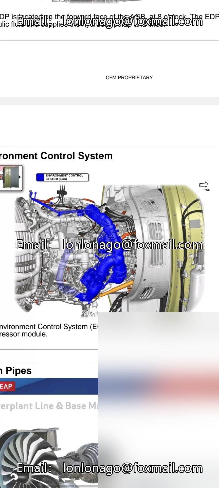
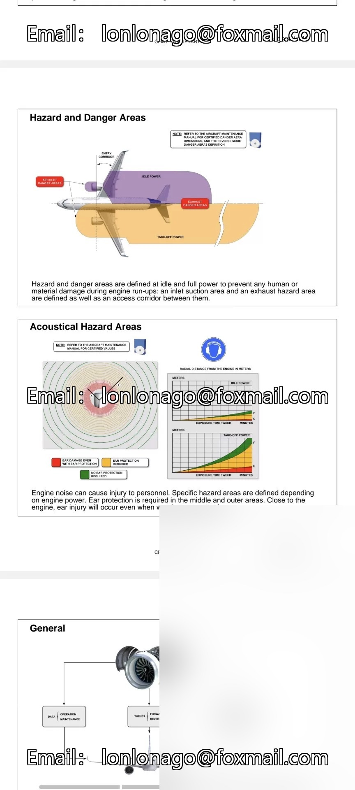
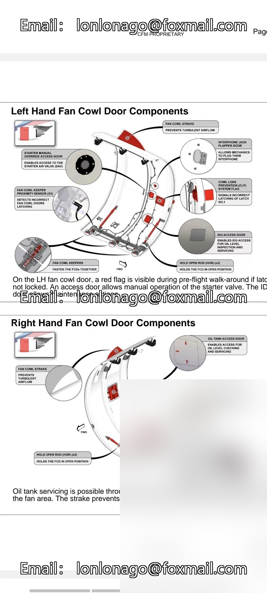
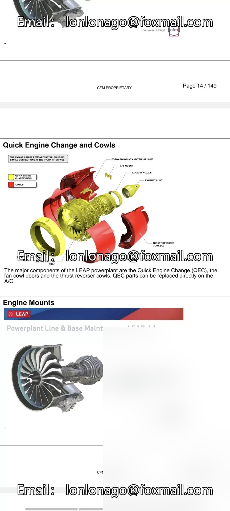
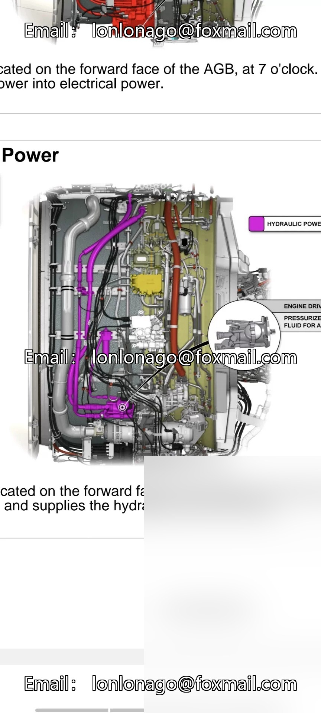
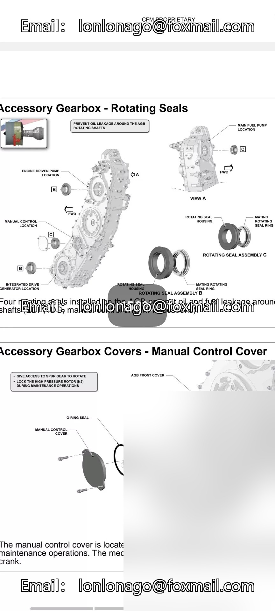

# LEAP-1A engine maintenance course outline, 140 pages.

## Body

LEAP-1A engine maintenance course outline, 140 pages.
The core content is a training document for aviation engine maintenance.
LEAP-1A is the highly efficient turbofan engine produced by CFM International, widely used in aircraft models such as Airbus A320neo, and its maintenance training is crucial for aviation safety.

The course outline covers 140 pages of LEAP-1A engine maintenance training, focusing on aircraft engine maintenance and including details on engine position, fluid supply and CFM systems.

<!-- AI_ENRICHED -->

## Images

## Payment

Here is a pay link on Stripe ( https://buy.stripe.com/3cs8yP7sY87d0vu9AB ). Please contact me lonlonago@foxmail.com after funding $89, and I will send you a complete data files , thank you!

